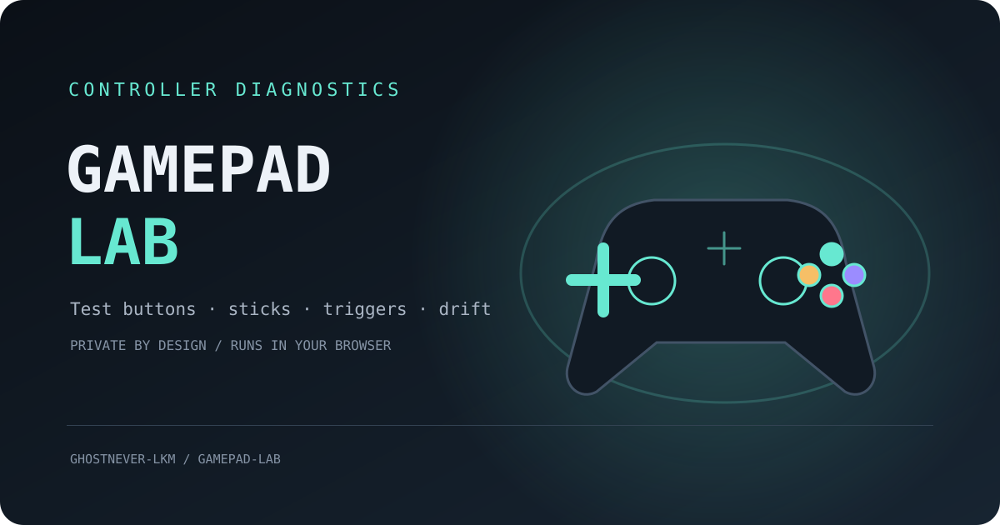

# Gamepad Lab

**A private, browser based controller test bench.** Watch buttons, analog triggers and stick axes respond live; check neutral stick stability; export a local JSON snapshot.

[Open the live app](https://ghostnever-lkm.github.io/gamepad-lab/) · [Report an issue](https://github.com/GhosTnever-lkm/gamepad-lab/issues) · [Support the project](https://buymeacoffee.com/azizazimov8)



## What it does

- Reads connected controllers through the browser's standard Gamepad API.
- Shows live button presses, analog button values, and paired stick positions.
- Displays the hardware reading (`raw`) separately from the optional radial deadzone view (`filtered`). The filter never changes the controller or its input to games.
- Measures stick center variation only after you start the check. Keep the controller still during the measurement.
- Downloads a compact JSON report directly to your device.
- Runs without an account, analytics, remote scripts, uploads, or a backend.

## Use it

1. Open the [Gamepad Lab page](https://ghostnever-lkm.github.io/gamepad-lab/) in a recent desktop browser.
2. Connect a controller, focus the page, and select **Find my controller**. Press a controller button or move a stick if the browser has not exposed it yet.
3. Test every button, both sticks, and the analog triggers. The API may use device-specific button and axis indexes when `mapping` is not `standard`.
4. For the drift check, set the controller on a flat surface and leave the sticks untouched for three seconds.
5. Select **Export report** to save the JSON locally.

### Run from a local checkout

Requires Node.js 18 or newer; there are no package dependencies.

```sh
npm start
```

Then open `http://127.0.0.1:4173`. Localhost is treated as a secure context by modern browsers, which is needed for many device APIs. Opening `index.html` directly with `file://` can block JavaScript modules.

## Reading the results

Each axis includes:

- **Raw** — the clamped value reported by the browser's Gamepad API.
- **Filtered** — a local visualization after applying the selected radial deadzone.

The center check reports measured sample counts, per-axis means, and observed variation. Its short measurement is an estimate, not a hardware certification or a repair instruction. Repeat it if movement was detected or the result says that more samples are needed.

## Privacy

Gamepad Lab processes controller readings in the current page. It does not send them to a server. The export includes only the browser-provided controller ID string, slot index, mapping, button and axis readings, timestamps, and any local calibration result. The browser API does not expose a stable serial number. Review the JSON before sharing it; some browsers include a controller model or vendor string in the ID.

The app deliberately has no network connection in its local server Content Security Policy. The public page itself is hosted by GitHub Pages.

## Browser notes

- Some browsers expose a controller only after a user gesture, such as pressing a button.
- Polling runs while the page is active and may be throttled in a background tab.
- Button and axis ordering depends on browser mapping and controller support. Unmapped devices can report different layouts.
- The Gamepad API does not expose a stable unique device identity or serial number.
- This is a browser tester, not an input remapper, game configuration utility, or hardware repair diagnosis.

## Project layout

```text
index.html             Accessible single-page interface
src/main.js            Browser polling, rendering, and local export
src/gamepad-core.js    Pure normalization, deadzone, calibration, and report logic
style.css              Responsive dark interface
serve.cjs              Dependency-free local development server
manifest.webmanifest   Installable web app metadata
```

## Support / Pro Version

Gamepad Lab is free and open source. There is no paid Pro edition for this project. If it is useful, you can [support development on Buy Me a Coffee](https://buymeacoffee.com/azizazimov8).

## License

MIT. See [LICENSE](LICENSE).
